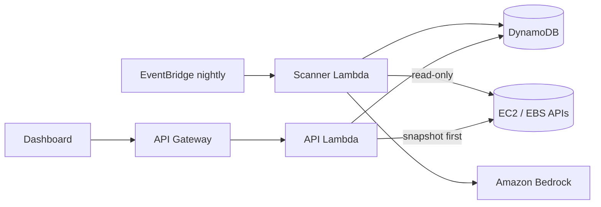

# Exorcist.exe

> Hunts the zombie resources haunting your AWS bill, explains why they are dead, and banishes them in one click.

Built for **Hack-To-ween** (AWS SBG IITJ x AWS SBG GSMCOE), Track 04: Open Innovation & Real-World Solutions.

## The problem
Idle EBS volumes, orphaned Elastic IPs and stopped instances keep billing long after anyone remembers them. Small teams and students rarely notice until the invoice arrives.

## How it works


1. A nightly **EventBridge** rule triggers the **scanner Lambda** (read-only on EC2).
2. Each zombie gets a plain-language explanation and a deletion-risk rating from **Amazon Bedrock** (with a deterministic fallback).
3. Findings are stored in **DynamoDB** and served by **API Gateway + Lambda**.
4. "Exorcise" snapshots an EBS volume before deleting it. Real deletion is **off by default** (`allowRealExorcism=false`).

## Demo mode
`GET /findings?demo=1` returns seeded data so anyone can try the product without an AWS account of their own.

## Deploy
```bash
cd cdk
npm install
npx cdk bootstrap        # first time only
npx cdk deploy
# Run a scan now:
aws lambda invoke --function-name <ScannerName from outputs> out.json
curl "<ApiUrl>/findings?demo=1"
```
Enable Bedrock model access for the model in `cdk.json` (`bedrockModelId`) in your region first.

## Cost and safety
Serverless pay-per-use, within or near AWS Free Tier for a few scans a day. Bedrock calls are small and capped at 200 tokens. Set an AWS Budgets alert before deploying. Prices in the app are static estimates.

## Business model
Freemium. Free scans for individuals. Paid tier for teams: multi-account scanning, Slack alerts, scheduled auto-cleanup, charging a percentage of verified monthly savings.

## Roadmap
- [x] Scanner, explainer, API (this commit)
- [ ] Haunted dashboard (S3 + CloudFront)
- [ ] Idle EC2 / RDS detection via CloudWatch
- [ ] Multi-account scanning

## License
MIT
