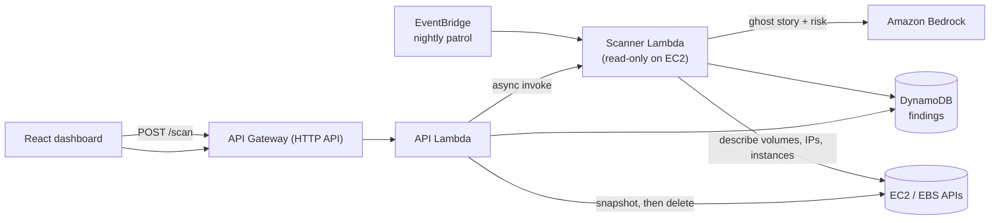

# 👻 Exorcist.exe

> *Your AWS account is haunted. Dead resources are still billing you.*
> *Find them. Hear their stories. Send them on.*

**Hack-To-ween** · AWS SBG IITJ × AWS SBG GSMCOE · Track 04: Open Innovation & Real-World Solutions
**Built by:** Prashi Jain, IIT Madras (team *Exorcist.exe*)

| | |
|---|---|
| 🕯️ **Live demo (sample-data mode)** | `[ADD CLOUDFRONT / VERCEL URL]` |
| 🎬 **Demo video** | `[ADD VIDEO URL]` |
| 📦 **Repository** | this repo |

---

## 🩸 The problem

On AWS, things get forgotten. A server is stopped but its disks keep billing. A volume is left behind after an instance is deleted. An Elastic IP is reserved and never used. Nothing breaks, nothing alerts, and the charges repeat every month until the invoice arrives.

Students, startups and small teams feel this most, because the money comes out of their own pockets, and they are the least likely to have a FinOps team watching.

## 💀 What Exorcist.exe does

It treats every forgotten resource as a ghost haunting your account.

1. **Finds them.** A scheduled scan looks for unattached EBS volumes, unassociated Elastic IPs and stopped EC2 instances, and estimates what each one costs per month.
2. **Explains them.** Amazon Bedrock writes a short plain-language story for each ghost (why it is probably dead, what it costs) and rates the danger of deleting it: low, medium or high.
3. **Banishes them.** One click. EBS volumes are **snapshotted first**, then deleted. Elastic IPs are released. Stopped servers are never auto-terminated.

The haunted interface is the Hack-To-ween theme. The cost problem underneath is real.

## 🏚️ Architecture



| Layer | Service | Role |
|---|---|---|
| Compute | AWS Lambda (Python 3.12) | Scanner and API |
| Schedule | Amazon EventBridge | Nightly scan |
| AI | Amazon Bedrock (Converse API) | Ghost stories and risk rating |
| Data | Amazon DynamoDB (on-demand) | Findings |
| API | Amazon API Gateway (HTTP API) | `GET /findings`, `POST /scan`, `POST /exorcise/{id}` |
| IaC | AWS CDK (TypeScript) | The whole backend, one `cdk deploy` |
| Frontend | React + Vite | The haunted dashboard |

## 🔒 Safety first (deleting things is scary)

- **Real deletion is OFF by default.** `allowRealExorcism` is `false` in `cdk/cdk.json`. In that mode the exorcise endpoint returns a dry run and deletes nothing.
- **Snapshot before delete.** EBS volumes get a snapshot before they are removed.
- **State check.** The API refuses to delete a volume unless its state is `available` (unattached). AWS itself also refuses to delete in-use volumes.
- **No auto-termination.** Stopped EC2 instances are reported for manual review, never deleted.
- **Read-only scanner.** The scanner role can only describe resources. Deletion permissions belong to the API Lambda only.
- **No secrets in the repo.** There are no keys in the code, and `.env` is git-ignored.

Known limitation: IAM cannot restrict `ec2:DeleteVolume` by volume state, so the state check lives in code. Tightening the Bedrock permission to a single model ARN is a planned improvement.

## 🕸️ Demo mode

Judges do not need an AWS account to try it. The dashboard's **Haunted demo realm** uses seeded sample findings, and the **Live AWS account** toggle connects to the deployed API.

Dashboard features: a bleeding-cost counter that follows the heartbeat sound, a ghost ledger with AI stories, a **Summon spirits now** scan button, step-by-step exorcism feedback ("Taking EBS snapshot…" then "Banishing spirit…"), a ₹ / $ currency switch, and a procedural horror soundscape generated in the browser (no audio files). Amounts are converted to rupees at a configurable approximate rate. AWS itself bills in US dollars.

## ⚰️ Run it yourself

**Requirements:** Node 18+, an AWS account, AWS CLI configured (`aws configure`), and Bedrock model access enabled in `us-east-1`.

```bash
# 1. Dashboard only (no AWS needed, demo mode)
cd frontend
npm install
npm run dev            # http://localhost:5173

# 2. Backend
cd ../cdk
npm install
npx cdk bootstrap      # first time only
npx cdk deploy         # prints ApiUrl and ScannerName

# 3. Connect the dashboard
cd ../frontend
echo "VITE_API_URL=<ApiUrl>" > .env
npm run dev
```

Run a scan from the command line:

```bash
aws lambda invoke --function-name <ScannerName> out.json && cat out.json
curl "<ApiUrl>/findings"
```

Set an **AWS Budgets alert** before deploying. Set the Bedrock model in `cdk/cdk.json` (`bedrockModelId`) to one that your account can access.

## 💸 Cost

Everything except Bedrock is serverless and pay-per-use, so a few scans a day sits at or near the AWS Free Tier. Bedrock calls are small (one short prompt per finding, capped at 200 output tokens), and the scanner falls back to a templated story if Bedrock is unavailable. Prices shown in the app are estimates from us-east-1 list prices.

## 📈 Business model

**Freemium FinOps for the long tail of AWS users.**

- **Free:** on-demand and nightly scans for a single account, with AI explanations.
- **Team tier (proposed):** multi-account scanning, Slack and email alerts, scheduled safe cleanup with approvals, and savings reports. Pricing would be a small percentage of *verified* monthly savings, so customers only pay when they save.
- **Who it is for:** students, hackathon teams, early-stage startups and small engineering teams without a dedicated FinOps function.
- **Why it can grow:** every AWS account accumulates orphaned resources over time, and the same scanner pattern extends to RDS snapshots, idle load balancers, NAT gateways and unused volumes across regions.

## 🗺️ Repository map

```
exorcist-exe/
├── cdk/                  # AWS CDK stack (DynamoDB, 2 Lambdas, EventBridge, HTTP API)
├── lambdas/
│   ├── scanner/          # finds ghosts, asks Bedrock for the story
│   └── api/              # /findings, /scan, /exorcise/{id}, demo seed data
└── frontend/             # the haunted React dashboard
```

## 🧙 Rubric guide for judges

| Criterion | Where to look |
|---|---|
| Event theme | The whole interface: gate screen, heartbeat, ghosts, banishing ritual |
| AWS implementation | `cdk/lib/exorcist-stack.ts`, `lambdas/` |
| Idea and problem | "The problem" above |
| UI / UX | `frontend/src/` or the live demo |
| Business model / scale | "Business model" above |
| Codebase and README | This file and the repository structure |

---

*The dead do not rest while they are billing you.* 🕯️

---

## 🚧 Deployment status (please read)

The backend (CDK stack, Lambdas, DynamoDB, API Gateway) is written and `cdk synth` succeeds, but I could **not deploy it to AWS before the deadline**: my AWS account signup was blocked at card identity verification. The live demo therefore runs in **demo mode on sample data**, and the dashboard says so in the toggle and footer. Everything needed to deploy is in `cdk/`; the steps are under "Run it yourself" above, and deploying is a single `cdk deploy`.
